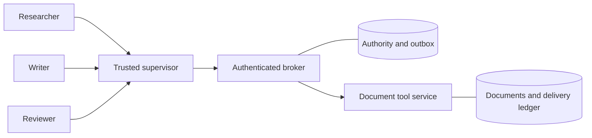

# Agent Boundary

A Python reference implementation of bounded tool authority for agent teams.
A researcher, writer, and reviewer propose document operations; an authenticated
broker checks each proposal before a separate document service performs it.
Durable quotas and request binding survive retries and process crashes.

This is a bounded engineering result. It does **not** solve AGI/ASI alignment,
general prompt injection, or containment of an arbitrarily capable attacker.
The implementation was built and reviewed by twelve engineering agents; the
running example has **three model roles**.

## Run it locally

Use Python 3.11 or later on a POSIX host (Linux or macOS) for the local
demo and test suite. Runtime dependencies are Python's standard library. Get the source and install it locally:

```sh
git clone https://github.com/sulmatajb/agent-boundary.git
cd agent-boundary
python3 -m venv .venv
. .venv/bin/activate
python -m pip install .
agent-boundary --backend deterministic
```

The command starts disposable broker and tool-service subprocesses, performs a
source read, draft append, and draft review over HTTP, then cleans up the local
fixture. Its JSON report labels this backend as a deterministic fixture, with
zero model calls. It is useful integration evidence, not a model evaluation.

Each local service has one 15-second readiness deadline after process creation,
covering receipt and validation of a complete JSON line. Partial or trickled
stdout does not restart that deadline. The line must fit within 4,096 bytes,
including its newline, and contain `ready: true` and an integer `port` as emitted
by the bundled services. EOF before the newline, malformed data and oversized
lines fail startup. A failed child is stopped and reaped through the existing
bounded cleanup before the error is returned; cleanup time is separate from the
readiness deadline. Private service logs remain local to the runtime directory.

For live model proposals, separately install **Codex CLI 0.158.0** on a POSIX
host and sign in to that CLI with your own ChatGPT account. The adapter rejects
other CLI versions because its tool-disabling flags are version-specific.

```sh
codex --version
agent-boundary --backend codex --timeout 90 --workflow-timeout 600 --max-rounds 4
```

This live path needs no provider API key. It uses the signed-in account's service
access and usage limits and requires network access; it is not an offline or
unconditionally free model. The trusted host CLI handles its own authentication.
The adapter does not read or copy login files and does not forward API-key
variables, broker credentials, or tool credentials to model proposals.

## Inspect a shared budget without services

From the source checkout, this smaller example needs only Python's standard library:

```sh
PYTHONPATH=src python3 examples/shared_budget.py
PYTHONPATH=src python3 examples/shared_budget.py --json
```

It delegates two sibling capabilities, each with a limit of two, beneath one
parent with a shared limit of two. Delegation spends nothing. One admission per
sibling exhausts the parent; a third distinct request fails even though that
sibling still has one admission left. After reopening the store, an identical
retry reuses the first admission without another charge, while a changed-payload
retry fails with `request_conflict`. The transcript and JSON show each counter.

This is an **admission-only** example using the production `Store` API. It
authenticates newly generated disposable fixture credentials through
`Store.authenticate`; it does not test HTTP authentication. Both admitted actions
remain pending and charged. No document is changed, no service starts, and no
tool or model is called. The temporary database is removed before output is
printed. No account credentials are needed or read.

## Walk through a lost acknowledgment and recovery

```sh
PYTHONPATH=src python3 examples/lost_ack_recovery.py
PYTHONPATH=src python3 examples/lost_ack_recovery.py --json
```

This disposable example uses the production `Store` and `ToolStore` APIs. One
append admission charges both parent and writer. The document adapter commits,
but the example deliberately withholds broker completion: the document has one
effect while the broker still has one charged, pending action. Both stores are
reopened, and the parent is revoked. A new request is denied even though quota
remains. Retrying the original request reuses its admission and saved tool
receipt, then completes with one document effect and no extra charge. Changing
that request's payload fails with `request_conflict`.

Text and JSON show each stage's budgets, pending/completed counts, delivery and
ledger counts, and a fixed synthetic draft. Generated credentials, action IDs,
private fixture content and host paths are omitted. Both temporary databases
are removed before output; there is no caller-supplied database-path option.

Withholding completion **models** a lost acknowledgment; no process is killed
and no HTTP packet is dropped. Reopening demonstrates local persisted state,
not the separate process-crash tests. Direct trusted-local calls do not test
HTTP authentication, concurrent dispatch or model behavior. The one-effect
replay result belongs to this document adapter; arbitrary external tools do not
inherit it. Revocation prevents new admission, not completion of admitted work.

## What is enforced

- Authenticated ownership and a fixed operation/resource catalogue are checked
  before tool dispatch. JSON proposed by a model is never authorization.
- Delegation narrows scope; admission atomically charges every ancestor's quota.
  Sibling agents share their ancestor's remaining budget.
- A request ID binds one full payload. Identical retries reuse the same admitted
  action, while changed-payload retries fail.
- An accepted action enters a durable outbox. Unknown outcomes remain charged.
  The document service's separate durable ledger deduplicates deliveries.
- A malformed successful reply remains an ambiguous outcome. The supervisor
  emits a controlled pending result and stops without a replacement dispatch.
- Revocation stops new admission. A previously admitted action can still finish.
- Append authority returns a version receipt, not the document's prior content.



The only tools are `document.read` and `document.append` on the logical resources
`source`, `draft`, and `private`. No proposed argument selects a shell, URL,
filesystem path, credential, or arbitrary external action. Read the precise
[protocol and trust assumptions](docs/PROTOCOL.md) and
[adversarial findings and repairs](docs/FINDINGS.md).

The broker, tool service, host supervisor, credentials, operating system, and
storage remain trusted. The default local demo runs under one host user; it is
not isolation for arbitrary hostile Python code. Authorized prose can still be
false or malicious, and authorized reads can be disclosed in later handoffs.
The deduplication guarantee applies to this document adapter, not arbitrary tools.

## Reproduce checks

Run all deterministic tests from the repository root:

```sh
PYTHONPATH=src python3 -m unittest discover -s tests -v
python3 scripts/release_check.py
```

For a sanitized test summary bound to the current Python source, run
`python3 scripts/verify.py`; it writes `evidence/tests.json` after the suite.
Review that generated evidence before including it in a release.

The suite covers authorization, HTTP parsing, account budgets, durable replay,
real process crashes, concurrency, adapter limits, and a seeded 2,000-request
adversarial campaign. No model or provider API key is required. To produce the
campaign report independently:

```sh
PYTHONPATH=src python3 scripts/adversarial_campaign.py --output work/generative.json
```

Docker Engine with the Compose plugin is optional. With Docker running, use
these disposable checks to exercise isolated worker networks, secret mounts,
separate data volumes, and an explicit syscall filter:

```sh
PYTHONPATH=src python3 scripts/container_check.py --output work/container.json
PYTHONPATH=src python3 scripts/container_check.py --workflow-backend codex --output work/live-container-workflow.json
```

The second command additionally uses the signed-in host CLI to propose actions
that the supervisor dispatches through the three isolated workers. Containers
receive neither login files nor a provider key. The check creates and removes
its own disposable Docker resources. See [container setup and limits](docs/containers.md)
for details and the deterministic workflow option.

## Recorded evidence

| Evidence | What the recorded run establishes |
| --- | --- |
| [Seeded campaign](evidence/generative.json) | 2,000 deterministic HTTP requests; no denied action produced a document effect |
| [Docker checks with deterministic workflow](evidence/container.json) | Passing checks; zero live model calls |
| [Live workflow through Docker workers](evidence/live-container-workflow.json) | Passing checks, six live proposals, three admitted document operations |
| [Live adversarial evaluation status](evidence/live-adversarial.json) | Blocked by automatic safety review; zero verified attack cases, not a passed evaluation |

The attempted live adversarial campaign was stopped by automatic safety review.
Partial progress is unverified. The successful benign live workflow and the
deterministic adversarial campaign do not close that live-attack evidence gap.

These files record particular runs, not a statistical estimate of future model
robustness or a proof against platform vulnerabilities. Deterministic tests,
live model behavior, and Docker restrictions are separate kinds of evidence.
Both Docker reports list six untested host alias/gateway routes; passing checks
do not establish those routes as blocked.

## Contribute and release

See [contribution instructions](CONTRIBUTING.md), [security policy](SECURITY.md),
[changes](CHANGELOG.md), and the [release checklist](docs/RELEASE.md).
Version 0.1.0 is an alpha reference implementation published at
[sulmatajb/agent-boundary](https://github.com/sulmatajb/agent-boundary).
See [GitHub Actions](https://github.com/sulmatajb/agent-boundary/actions) for hosted
validation. No package-registry release is implied by this source publication.

Project code is [MIT licensed](LICENSE). The unmodified Moby seccomp profile has
separate Apache-2.0 terms; see [third-party notices](THIRD_PARTY_NOTICES.md) and
[profile provenance](security/README.md).
