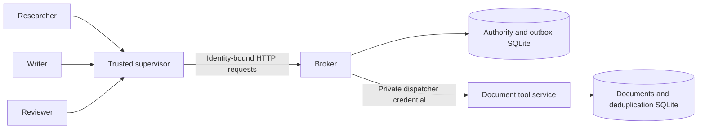

# Authority, admission, and recovery

The problem addressed here is preserving delegated tool authority across agent
handoffs, retries, and process crashes. Models can propose hostile actions; an
authenticated broker decides whether to admit them before contacting the tool.
This is a bounded engineering result, not a solution to general AI alignment.

## Components and trust

The three model roles exchange public task results through the supervisor. Each
Codex turn receives a bounded JSON envelope, with built-in tools disabled. The
supervisor supplies the credential, capability, and unique request ID; the model
supplies only an operation, logical resource, literal value, and public message.
The model is not entrusted with authorization. A valid output schema alone does
not establish permission.

The broker, tool implementation, supervisor, operating system, database files,
and credential provisioning are trusted. `LocalSystem` is a convenience process
supervisor under one user account. It does not isolate arbitrary hostile code
running as that user. The separate Docker test exercises worker network and
filesystem restrictions. Neither configuration claims protection against a
compromised host, Docker daemon, kernel, or trusted supervisor.

## HTTP contract

All mutations require a single `Authorization: Bearer <token>` header. The
authenticated principal comes from the credential database, never a body field.
Every body has exactly the documented keys. JSON duplicate keys, nonfinite
numbers, invalid Unicode, oversized bodies, ambiguous framing, and unknown
routes fail closed. Internal clients ignore environment proxies and reject
redirects. Plain HTTP is limited to loopback or the isolated container networks;
use an independently hardened TLS deployment before considering remote service.

| Route | Body / authority |
| --- | --- |
| `GET /health` | Constant public health response |
| `POST /v1/root` | `owner, scopes, budget`; administrator only |
| `POST /v1/delegate` | `capability, owner, scopes, budget`; parent owner only |
| `POST /v1/revoke` | `capability`; owner or administrator |
| `POST /v1/execute` | `capability, request_id, operation, resource, value`; owner |
| `GET /v1/audit` | Administrator only; first 100 action metadata records |
| `POST /v1/audit-page` | `offset, limit`; administrator; at most 1,000 records |
| `POST /v1/drain` | Empty object; administrator retries up to 100 pending intents |

The separate tool service accepts only `POST /apply` with `action_id, operation,
resource, value`, protected by its own dispatcher credential. Its health endpoint
is public. It has no HTTP audit route.

The fixed catalogue contains `document.read` and `document.append` on `source`,
`draft`, and `private`. These are exact logical names, not filesystem paths or
URLs. Reads require a null value. Appends accept a literal Unicode string of at
most 4,096 characters. The adapter does not interpret commands or instructions
inside document content.

An append returns only `{resource, version}`. It never returns existing document
text, because write authority does not imply read authority. A read returns
`{resource, content, version}`. Documents are capped at 64 KiB of UTF-8 content.
The tool rejects an append that exceeds that limit before changing its state;
the broker's already-admitted intent remains charged and pending. Recovery
requires trusted operator intervention when the tool cannot accept that intent.

The supervisor accepts a completed execute reply only with the documented
receipt for the proposed operation and resource: an integer version (positive
for appends, nonnegative for reads), and valid Unicode content within the 64 KiB
UTF-8 document limit for reads. Append receipts must not include content.
The broker applies this same receipt contract before durably marking an action
completed. An invalid successful tool reply leaves the admitted action pending
and charged, so a later drain can retrieve the tool's saved valid receipt using
the same action ID without repeating its effect. This does not repair malformed
receipts already recorded by older broker versions.

A pending reply has no result. A successful HTTP response with missing or
malformed status/receipt fields is still ambiguous, even if its JSON parses.
`BoundToolChannel` returns `pending` with `invalid_response` without including
the raw reply. The workflow stops without a replacement request or quota refund;
an HTTP success alone cannot establish either completion or denial.

HTTP audit records omit request values and result bodies. Pages include
`total_actions` and `next_offset`; use `BrokerClient.audit(offset=next_offset)`
until the latter is null. Each page is a transactionally consistent snapshot;
separate pages can observe later completions or new admissions. Trusted local
database access and `Store.snapshot()` remain available for full inspection.

## Delegation and budgets

A child scope must be a nonempty subset of its parent's scope. Every ancestor
must be live, and a child's limit cannot exceed any ancestor's remaining quota
at delegation time. Delegation itself does not reserve quota. Sibling branches
share ancestor capacity and can compete for it; this is a ceiling, not a
fairness or scheduling guarantee.

For every capability `c`, the broker maintains:

`spent(c) = number of durably admitted actions in c's subtree <= limit(c)`.

An action admission checks ownership, scope, revocation, and capacity throughout
the lineage in one SQLite `BEGIN IMMEDIATE` transaction. It increments every
ancestor and inserts a pending action atomically. Successful commit is the
authorization linearization point. SQLite uses WAL, foreign keys, a busy timeout,
and FULL synchronous mode; correctness assumes functioning local durable storage.

## Replay, crash, and revocation semantics

The tuple `(capability, request_id)` binds the entire operation/resource/value
payload. Identical retries return the same action; different payloads conflict.
Ownership is checked before replay. A replay does not consume additional budget.

The runnable [shared-budget example](../examples/shared_budget.py) demonstrates
the sibling ceiling and persisted request binding together, using direct
production `Store` calls and a disposable database. Run it from the checkout with
`PYTHONPATH=src python3 examples/shared_budget.py --json`. Its admissions remain
pending and charged; it performs no tool effects and does not exercise HTTP
authentication, concurrent scheduling, or crash injection.

The dispatcher contacts the tool only after reservation commits. The tool
transaction atomically applies a document operation and stores its result under
the broker's action ID. Concurrent or later deliveries return that saved result.
Even a replayed read returns its original snapshot. This supplies one durable
document effect per admitted action for this specific adapter. An arbitrary
remote tool without equivalent idempotency does not inherit that guarantee.

| Failure point | Durable state and recovery |
| --- | --- |
| Before reservation commits | No admitted intent; no tool dispatch |
| After reservation, before tool commit | Charged pending intent; replay or drain delivers it |
| After tool commit, before broker records result | Charged pending intent; redelivery retrieves the saved result without repeating the effect |
| After broker completion | Identical retry returns the recorded result |

Uncertain outcomes never refund quota. Pending intents remain charged, including
when the tool is unavailable. Revocation prevents **new admission**; an already
admitted intent can finish after revocation or restart. Operators must not treat
revocation as cancellation of a committed outbox entry.

The supervisor stops its workflow on an ambiguous outcome. It does not generate
a replacement action to hide the uncertainty. Recovery is an explicit trusted
operation. The reference service has no automatic background drain, credential
rotation, ledger pruning, cross-host consensus, or production availability SLA.
Drain scheduling durably rotates toward least-attempted pending intents, so a
batch of permanently rejected appends does not hide later deliverable actions.
This is retry scheduling, not an exclusive lease or guaranteed completion.

## What the boundary does not decide

An authorized writer can append false or malicious prose to its authorized
document. A read-authorized role can disclose that content in its public handoff.
The broker constrains identities, operations, resources, and admission counts;
it does not prove semantic correctness, confidentiality after an allowed read,
absence of prompt injection, or safe behavior of arbitrary future tools.

The tests exercise concrete implementations and failure windows. They are not
a proof of all Python executions or a statistical estimate of every future
model's attack success rate.
