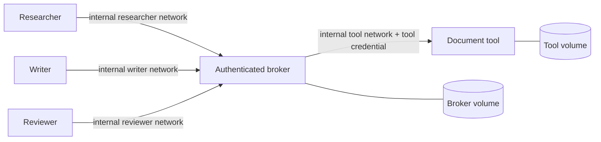

# Docker containment

Run the disposable, deterministic containment check with Docker Engine and the
Docker Compose plugin installed and running:

```sh
PYTHONPATH=src python3 scripts/container_check.py --output work/container-evidence.json
```

The script builds the digest-pinned Python image, creates fresh random
credentials, starts five containers, exercises actual HTTP tool operations,
attacks the worker boundary, restarts the broker and tool, and removes its
containers, networks, volumes, temporary secrets, and image tag. The JSON report
contains check names and outcomes, never credentials or document payloads. A
failed check exits nonzero. It requires Docker administrator access; run it only
on a host where you trust the supervisor and Docker daemon.

## Deployed boundary



Each worker has one internal Docker network shared only with the broker, and
mounts only its own bearer token and an ephemeral `/tmp`. The broker joins the
three worker networks and the separate internal tool network. The tool has no
worker network. Broker and tool use different named database volumes. No
service publishes a host port, and no container receives the Docker socket,
host home directory, provider key, or Codex sign-in files.

All five containers run as UID/GID 10001 with a read-only root filesystem, all
Linux capabilities dropped, `no-new-privileges`, an explicit pinned Moby seccomp filter,
a 64-process limit, 128 MiB memory limit, and one CPU limit. Their writable
`/tmp` is a 16 MiB tmpfs with `noexec,nosuid,nodev`. Broker and tool additionally
write their own `/state` volumes. Python can execute supplied code; `noexec` is
an extra filesystem restriction, not a claim that worker code cannot run.

The syscall filter comes from Moby v28.1.1; see
[profile provenance and upstream license](../security/README.md). The first
real test found the local daemon's default was `unconfined`, so Compose applies
the profile explicitly and the check requires active filter mode in each
worker. A daemon's default security policy is not assumed.

The host supervisor crosses this boundary deliberately using `docker compose
exec -T`. Worker requests use the worker's own mounted token and the broker's
HTTP API. Administrative bootstrap and audit run within the trusted broker
container. Workers can reach the broker health route without credentials, but
all authority routes require a valid bearer credential.

## What the check demonstrates

The check verifies the deployed Docker settings and runs code inside every
worker to confirm nonroot execution, zero effective capabilities, seccomp and
no-new-privileges status, denied raw sockets, a read-only application filesystem,
and absence of broker/tool database files, the tool credential, other workers'
credentials, host Codex directories, and Docker socket.

Each worker can reach broker health but fails unauthenticated and invalid-token
audit requests. A healthy tool service is unreachable by both DNS name and
container IP. A controlled listening canary on a separate ordinary Docker
network is unreachable by container IP, and a second worker listening fixture
is unreachable from the other workers. An ordinary external control container
first verifies the canary's exact IP, and the broker verifies the tool and peer
worker IP listeners. Host alias and gateway routes are counted as blocked only
when an external control container can reach that same address and port.
Unavailable hostnames, absent gateways, and unreachable positive controls are
listed explicitly in `untested_network_routes`, never counted as passing
isolation checks. Host alias probes use the addresses resolved inside each
worker; gateway discovery also checks Docker network IPAM configuration.
These tests never probe an unrelated public service. They establish the tested
routes are blocked; they are not an exhaustive proof against kernel, Docker,
host-networking, DNS, or future platform vulnerabilities.

A three-worker delegation chain then reads source, appends draft, and reviews
draft through the broker. The check confirms unauthorized private reads,
capability theft, worker admin access, and budget overrun fail; ancestor counters
are 3/2/1; and the tool ledger has three durable actions with one draft append.
Replaying the append after restarting broker and tool returns the original
result without creating another append.

By default this check is deterministic code execution and transport/isolation
evidence. It does not run a language model. The normal `agent-boundary --backend codex`
workflow uses a trusted host supervisor and local subprocess services; that
separate live evaluation does not, by itself, establish Docker containment.
Docker containers share a kernel and are not a claim of containment against an
arbitrarily capable attacker. Host root, the Docker daemon, broker process,
bootstrap credentials, and supervisor remain trusted.

## Optional workflow through the isolated workers

The check also supports the application's supervisor and proposal backend with
container-bound clients:

```sh
PYTHONPATH=src python3 scripts/container_check.py --workflow-backend deterministic --output work/container-workflow.json
PYTHONPATH=src python3 scripts/container_check.py --workflow-backend codex --output work/live-container-workflow.json
```

Both options first run the deterministic containment checks, then create a new
three-operation workflow capability under the same disposable services. The
`codex` option uses the separately installed, supported Codex CLI with the
operator's existing ChatGPT sign-in on the trusted host. The model returns
bounded proposals; the host supervisor dispatches each accepted proposal
through the corresponding worker container, which reads only its own bearer
token and calls the broker over its internal network. No provider API key is
needed or forwarded, and Codex login files remain on the host.

The report labels the optional backend, live model call count, completion and
budget accounting separately from the deterministic containment checks. It
omits prompts, transcript text, model reasoning, credentials and document
payloads. Live completion is evidence of that observed workflow, not a general
model robustness or adversarial safety claim.

The checked-in [deterministic report](../evidence/container.json) and
[live container report](../evidence/live-container-workflow.json) record
their passing checks and any untested network routes separately. The live
report records six Codex CLI 0.158.0 calls, three
completed roles, and shared usage of three operations with one per role. These
are observations from the recorded run, not guarantees about future models or
deployments.

## Start a persistent local fixture

Create the secrets in a new private directory outside the repository. No
credential is printed:

```sh
export AB_RUNTIME_DIR="$(mktemp -d)"
python3 scripts/container_check.py --bootstrap "$AB_RUNTIME_DIR"
docker compose up --build -d --wait
```

Compose local secrets use bind-mounted files. Files are mode 0444 so the
container's nonroot UID can read the selected mount; the enclosing host
directory is mode 0700. The worker receives only its individual selected file,
never that host directory. Do not copy these generated files into the source
tree, images, evidence, version control, or another worker's mount.

The supervisor can execute Python clients in the relevant container:

```sh
docker compose exec -T researcher python -c '
from pathlib import Path
from agent_boundary.client import BrokerClient
client = BrokerClient("http://broker:8765", Path("/run/secrets/worker_token").read_text())
# Use only a capability issued to researcher by the trusted administrator.
'
```

Database state persists across `docker compose restart` and `down`/`up`.
Keep the original bootstrap files when reopening those volumes: fresh tokens
intentionally fail bootstrap against existing principal identities. To remove
the disposable fixture and its data:

```sh
docker compose down --volumes --remove-orphans
rm -r -- "$AB_RUNTIME_DIR"
unset AB_RUNTIME_DIR
```

Do not mount authenticated host CLI state into workers or give them access to
`docker exec`. Keep the signed-in Codex CLI with the trusted host supervisor
and pass only bounded proposal JSON to the worker transport.
